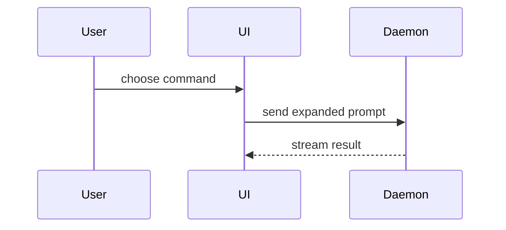

Use this template for writing the PR body:

```markdown
## Why

<!-- 1–3 sentences explaining the problem and approach. Link context or parent epic if applicable. -->

## What changed

<!-- Concise summary or diff-sketch of the modifications. -->

## How it was tested

- **Models Used**: `builder: <builder-model>`, `auditor: <auditor-model>` (read from `models.yml`)
- **Runtime Proof** (`exitCode: 0`):
```text
# verification command output
```
- **Audit Verdict**:
```text
verdict: PASS
```

Closes #<!-- number (never use Refs #N; for final deploy sub-issue of an epic, also add Closes #EPIC) -->
```

## Sections

Skip all preambles and keep prose brief. Use the user's domain language from `GLOSSARY.md`.

### Why

Brief explanation of the problem, motivation, and solution approach (1–3 sentences). Link parent issues or specifications.

### What changed

Pick the smallest view that makes the key point clear.

- Show logic or an algorithm as pseudocode:

```text
on(save)
  if content is unchanged
    return cached result
  write new content
  return fresh result
```

- Show runtime control flow as a call tree:

```text
submitForm
  createSession
    persistPrompt
    launchAgent
  navigateToSession
```

- Show UI structure as a component tree, including state and module boundaries that matter:

```text
<SessionPage> (apps/example/src/routes/session.tsx)
  useSessionEvents()
  <SessionToolbar>
    <RunSkillButton> (packages/ui)
```

- Show file responsibility or a broad refactor as a shallow file tree:

```text
src/
├── commands/       # parses user actions
├── sessions/       # owns session state
└── transport/      # sends API requests
```

- Show component interaction, control flow, or data flow with Mermaid:



- Use `diff` when the point is what changes and the surrounding shape already exists. Match the diff shape to the topic.

For a component change:

```diff
 <SessionPage>
   useSessionEvents()
   <SessionToolbar>
+    <RunSkillButton />
   <SessionTimeline>
+    <SkillResultCard />
```

For a file-layout change:

```diff
 src/
 ├── commands/
+│   └── show-me.ts       # expands the slash command
 ├── sessions/
-└── transport.ts
+└── transport/
+    ├── client.ts
+    └── stream.ts
```

For a call-tree or call-stack change:

```diff
 submitForm
   createSession
     persistPrompt
+    expandSkillMention
     launchAgent
-  navigateToSession
+  navigateToSession
+    subscribeToEvents
```

For a state or control-flow change:

```diff
 on(save)
-  write content
+  if content is unchanged
+    return cached result
+  write new content
+  invalidate cache
```

- Show the whole block when most of it is new, when omitted context would hide ownership or order, or when the user needs a copyable target shape:

```ts
function expandSkill(command: string): string {
  const skillName = command.slice(1);
  return `use the ${skillName} skill`;
}
```

#### Guidance

Place each visual next to the short text it supports. Keep only the calls, files, props, states, and boundaries needed to answer the user's current question or the options to resolve the current discussion point.

You may use one of these, you may use several, it is unlikely you will use all of them. Use your judgement and don't overwhelm the user.

### How it was tested

Concrete evidence and verification that the change works.
- Include models dynamically read from `models.yml` (`builder` and `auditor`).
- Include runtime verification proof (Phase 4a `verify-app` or test run output with `exitCode: 0`).
- Include independent adversarial interrogation verdict (Phase 4b Grok audit `verdict: PASS`).

Screenshots are S-tier for visual changes.
Execution-based evidence is A-tier: test results, console output showing exact tests passing.

### Closes #N

Mandatory issue closing directive. Always use `Closes #N` (never `Refs #N`). For the final deploy sub-issue of an epic, also append `Closes #<EPIC_NUMBER>`.
